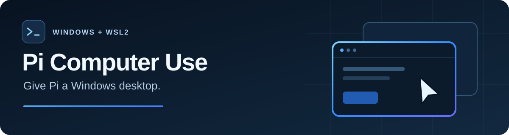

# Pi Computer Use



[](https://github.com/ycheung5/pi-computer-use/actions/workflows/checks.yml)
[](LICENSE)


**Let your Pi agent work with Windows apps and browser pages.** Read controls, take screenshots, enter text and complete tasks from native Windows or WSL2.

A standalone Pi extension with **25 computer-use tools**, a blue control border and explicit ways to stop or take back control. It uses your existing Pi model setup.

[Install](#install) · [Example tasks](#try-it) · [Capabilities](#what-pi-can-do) · [Documentation](docs/README.md)

> **Tested baseline:** Windows 11 x64, WSL2 Ubuntu and Pi SDK/CLI 1.4.0. See the [release status and known limits](docs/validation.md#first-release-preparation) for the exact accepted scope.

## What Pi can do

| Capability | What it enables |
| --- | --- |
| Windows apps | Discover windows and controls, inspect their state, invoke buttons and manage windows. |
| Browser pages | Work with forms, tabs, navigation, dialogs and file transfers through a browser protocol channel. |
| Visual tasks | Capture screenshots and read visible text with Windows OCR. |
| Desktop input | Move, click, drag, scroll, type Unicode text and send keyboard shortcuts. |
| Clipboard workflows | Paste text with preservation and cleanup checks; refuse unsupported preservation cases. |
| Control and preferences | Show a blue border during exclusive control, stop active work and choose which tools Pi loads. |

For ordinary app requests, Pi is guided to use Windows defaults and reuse an existing window with a separate tab or workspace when the app supports one. Dedicated browser automation uses a separate profile when that workspace is explicitly selected. [Workspace policy](docs/windows.md#default-apps-and-workspaces)

## Install

Use your existing Pi installation. Another computer-use extension is not required.

### From npm

Install [@ycheung5/pi-computer-use](https://www.npmjs.com/package/@ycheung5/pi-computer-use) from npm:

```sh
pi install npm:@ycheung5/pi-computer-use
```

Use the scoped name above. The unscoped `pi-computer-use` package belongs to a different publisher.

### Build and try this checkout

With Node 22.19+ and npm:

```sh
git clone https://github.com/ycheung5/pi-computer-use.git
cd pi-computer-use
npm ci --ignore-scripts
npm run build
pi -e .
```

To retain the built checkout as a local Pi package, run `pi install .` from that directory. Source checkouts do not include compiled output; build before registering the package.

### Install a built archive

For a prebuilt `ycheung5-pi-computer-use-0.1.0.tgz` produced by `npm pack`:

```sh
mkdir pi-computer-use
tar -xzf ycheung5-pi-computer-use-0.1.0.tgz -C pi-computer-use --strip-components=1
cd pi-computer-use
npm install --omit=dev --omit=peer --ignore-scripts
pi install .
```

Pi supplies its SDK and TypeBox peers. The archive contains compiled code, so this path needs no TypeScript compiler. Keep the extracted directory while Pi references it.

### Requirements

- **Windows 11 x64**, directly or through **WSL2 Ubuntu**, with an interactive desktop. WSL needs Windows executable interop, `cmd.exe` and `wslpath`.
- **Pi** with your configured model. Tested SDK/CLI: **1.4.0**. A vision-capable model is needed to interpret screenshots; credentials are not bundled.
- **Windows PowerShell 5.1** and the built-in .NET Framework compiler/desktop assemblies. A separate .NET SDK or Windows Node installation is not required.
- **Chrome or Edge** for supported browser workflows. Explicitly selected installed Firefox-family browsers are experimental.
- **Windows OCR language support** for the text you want to recognize.

The first computer-use call downloads a pinned, checksum-verified private Windows Node runtime from nodejs.org into `%LOCALAPPDATA%\pi-computer-use\runtime`. Later calls reuse the worker. Initial setup needs HTTPS access to nodejs.org and does not change your global Node installation.

## Try it

Start with a read-only connection check:

```text
Call windows_computer_use_health, then list the open windows.
Do not activate a window or send any input.
```

Then give Pi a goal. These are example requests, not promises of support for every app:

```text
Use Notepad to create a separate test document. Keep any existing documents
unchanged. Type "Hello from Pi — 中文 café 😀" and verify the editor text.
Leave the test document open and unsaved.
```

```text
Open https://example.com in my Windows default browser. Reuse an existing
window with a new tab if possible, then tell me the page title.
```

```text
Find my Downloads window and summarize its visible controls.
Do not click, type or activate it.
```

## Stay in control

A **blue gradient border** marks exclusive desktop control. During that period, Windows hooks suppress ordinary physical input so it does not compete with the agent.

- Press **Esc** when physical-input protection is armed, or use **`/computer-stop`** in Pi, to interrupt active work.
- When a task needs your input, the agent should release control and wait for your explicit continuation.
- Timed-out or cancelled input is not automatically replayed. Unconfirmed cleanup blocks dependent automation.

Windows can silently remove timed-out hooks. Suppression and physical stop keys cannot be guaranteed after that OS behavior; detected protection loss stops automation. Read the [control and stopping contract](docs/stopping.md) before relying on unattended desktop work.

## Make it yours

```text
/computer-settings show
/computer-settings edit
/computer-settings set {"toolPreset":"lazy"}
```

Settings are shared across projects and native Windows/WSL2 Pi in `%LOCALAPPDATA%\pi-computer-use\settings.json`. Choose full, lite, lazy or custom tool loading, plus browser and indicator preferences. The local border remains required during exclusive control. [Settings guide](docs/settings.md)

## Tested scope and known limits

The release audit recorded **187 passing portable tests**, one opt-in historical-reference skip, and checks of the built distribution. Named native/browser agent workflows and human control/display checks have separate [acceptance receipts](docs/validation.md#capability-coverage). CI is not a claim that every application or desktop state works.

- Second-computer WSL installation and desktop actions were user-confirmed. Fresh native-Windows installation, broken-prerequisite handling and shutdown in that clean environment remain accepted, unverified first-release test limitations.
- Display mapping was exercised at **100%, 150% and 175%**, including a changed negative-origin layout. Other configurations, including 200%, remain unverified.
- Windows may refuse foreground activation or access to elevated/protected interfaces. The extension reports refusal rather than bypassing Windows protections.
- Explicit Unicode SendInput retains a **50 ms per-unit delay**. Clipboard preservation has format-dependent limits; installed Firefox support is experimental.
- Arm64, genuine same-HWND/PID reuse, verified UIPI denial and additional recorder/remote/capture variants remain unverified.

See the [release scope](docs/validation.md#first-release-preparation) for the accepted limits and their evidence.

## Develop and verify

```sh
npm run check
npm run test:package
```

Build with `npm run build`; individual checks are `npm test`, `npm run typecheck` and `npm run lint`. Format with `npm run format` or apply configured fixes with `npm run lint:fix`. Packaging verifies compiled/native assets, licenses, metadata and documentation links.

Live Windows and paid-model runners are opt-in. Read their [prerequisites and evidence scopes](docs/validation.md#reproduce-automated-checks) before running them; serialize live WSL checks with `flock -w 120 /tmp/pi-cu-live-tests.lock`. Historical DSH comparisons are optional developer utilities, not release prerequisites.

[Documentation index](docs/README.md) · [Requirements](docs/spec.md) · [Implementation plan](docs/implementation-plan.md) · [Report a bug](https://github.com/ycheung5/pi-computer-use/issues)

## Troubleshooting

| Symptom | Check |
| --- | --- |
| `WORKER_ASSET_MISSING` | Build the checkout or use a built package. |
| Runtime download or checksum failure | Allow nodejs.org HTTPS. Remove only the indicated corrupt private-runtime cache before retrying on a trusted connection. |
| `WSL_BOOTSTRAP_FAILED` | Check Windows interop, `cmd.exe` and `wslpath`. A sandbox `UtilBindVsockAnyPort` failure is an execution restriction. |
| Native compiler or OCR unavailable | Check Windows Framework/desktop components and installed OCR languages. |
| Desktop busy or stopped | Finish or stop the owning operation, then provide new user input. Do not replay uncertain actions through another tool. |

## License

[MIT](LICENSE). Created by **ycheung5**. Bundled notices: [Node](assets/node-LICENSE.txt) and [Puppeteer](assets/puppeteer-LICENSE.txt). Installed dependencies retain their own licenses.
